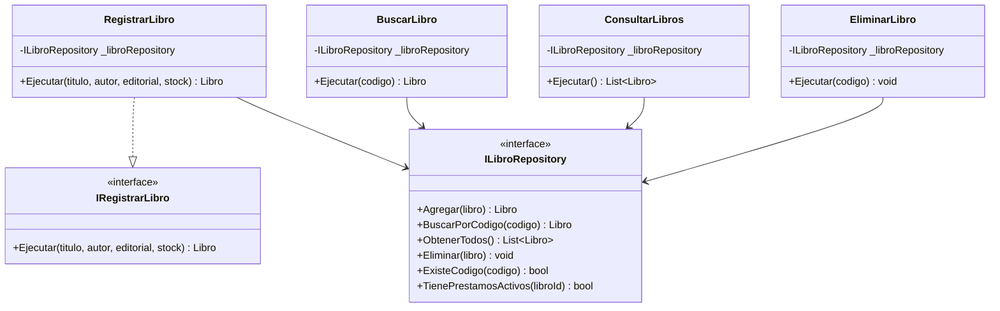
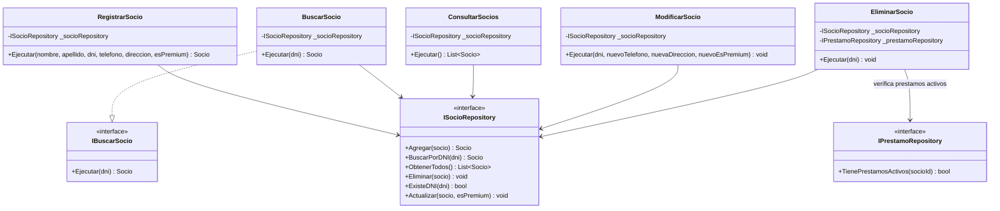
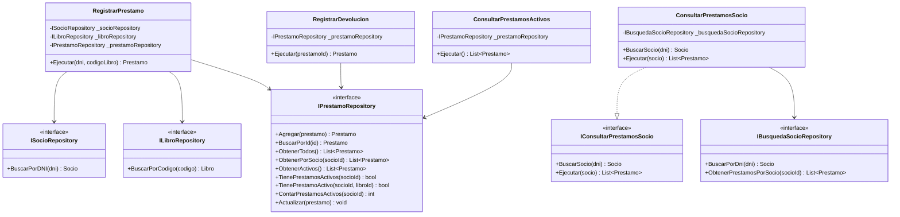

<!-- Para visualizar el diagrama UML, presionar Ctrl + Shift + V para abrir la vista previa de Markdown. -->

# UNAJBOOKS — Diagramas de la capa Application

Estos diagramas muestran los casos de uso de la aplicación, las interfaces que implementan y los repositorios de los que dependen.

## 1. Casos de uso de libros

## 2. Casos de uso de socios

## 3. Casos de uso de préstamos

