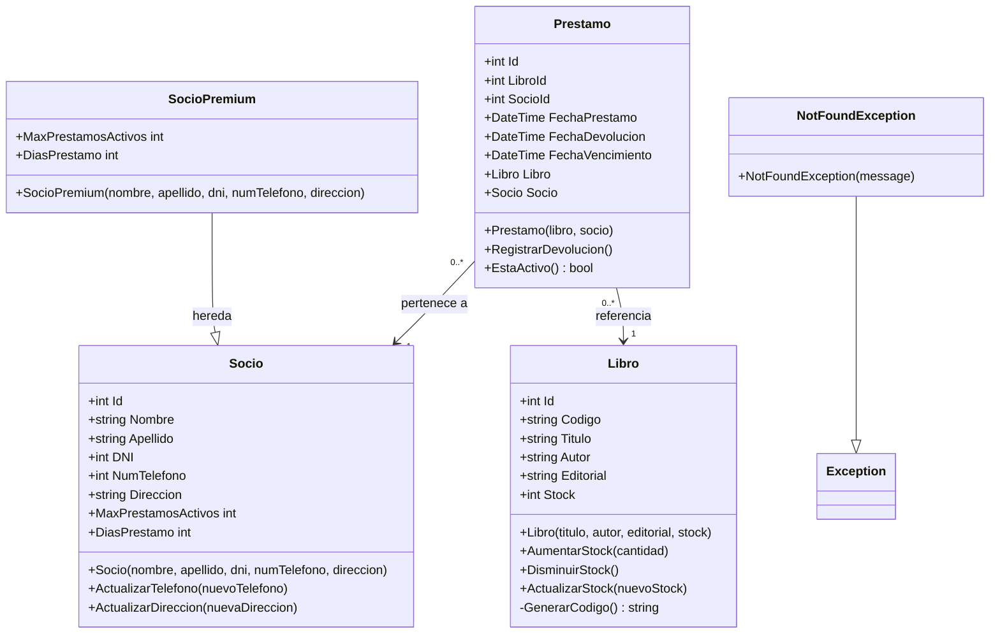

<!-- Para visualizar el diagrama UML, presionar Ctrl + Shift + V para abrir la vista previa de Markdown. -->

# UNAJBOOKS — Diagrama de dominio

Este diagrama muestra las entidades del dominio, sus atributos, sus operaciones y sus relaciones.

