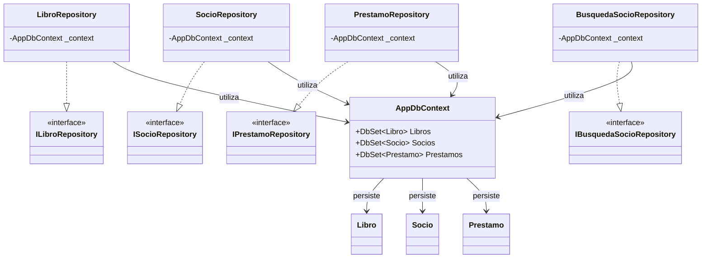

<!-- Para visualizar el diagrama UML, presionar Ctrl + Shift + V para abrir la vista previa de Markdown. -->

# UNAJBOOKS — Diagrama de infraestructura

Este diagrama muestra los repositorios concretos, las interfaces que implementan y su relación con el contexto de persistencia.

## Repositorios y persistencia

