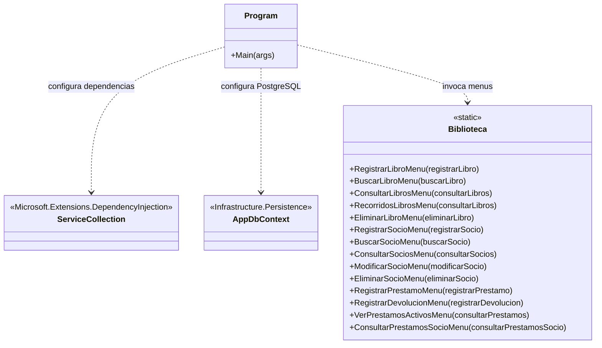
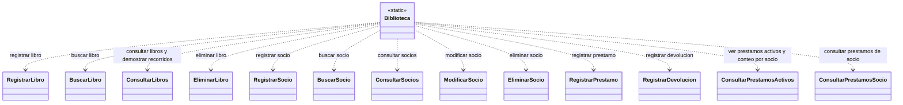

<!-- Para visualizar el diagrama UML, presionar Ctrl + Shift + V para abrir la vista previa de Markdown. -->

# UNAJBOOKS — Diagrama de presentación

Este diagrama representa el punto de entrada del programa, el menú principal y la relación de los menús con los casos de uso.

## 1. Entrada del programa

## 2. Menús y casos de uso

